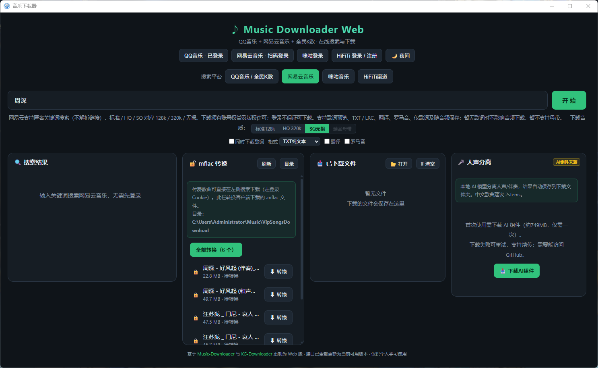
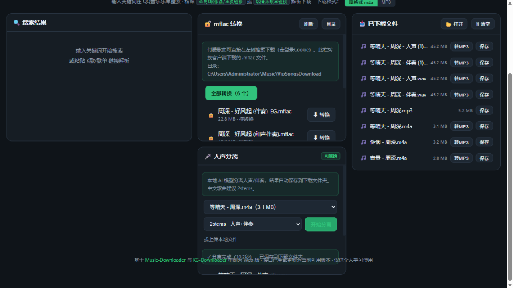
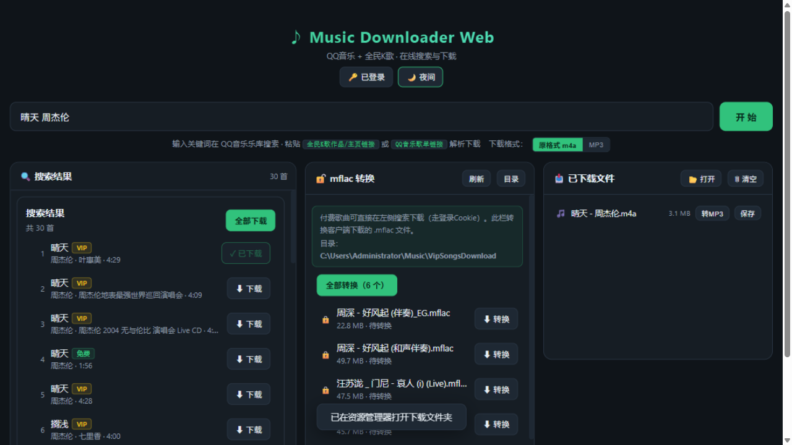

# Music Downloader Web

**当前发布：v1.3.1-desktop（Windows x64 桌面版）** · [Release 下载](https://github.com/MeowAndy/Music-Downloader-Web/releases/tag/v1.3.1-desktop) · [安卓 APK 方案与可行性](docs/android-apk-plan.md)

本次将网易云、咪咕、HiFiTi 原生渠道、歌词、条件 NCM 处理、AI 下载改进及四栏布局合并发布。下载干净 EXE／ZIP 后使用自己的账号；不携带开发者凭据。下文涉及早期“未打包／未推送”的文字为相应功能开发时的历史验证边界，不代表此次 Release 状态。安卓仍只有方案，没有已发布 APK。

🎵 一站式音乐工具：**QQ音乐搜索/下载（标准·HQ·SQ无损·臻品母带四档音质）+ 网易云搜索/按权益下载 + QQ／网易云歌词 + 咪咕搜索／按下载事务授权保存音频／原文歌词+ 全民K歌下载 + mflac解密 + 本地AI人声分离**，纯本地运行的 Web 应用。

基于 [Music-Downloader](https://github.com/Li4n0/Music-Downloader) 与 [KG-Downloader](https://github.com/T-K-233/KG-Downloader) 重制，接口全部更新为当前可用版本。

### 桌面版



*桌面版*

### 网页版界面




## ✨ 功能

| 功能 | 说明 |
|------|------|
| QQ音乐搜索 | 关键词搜索乐库，免费/VIP 标记 |
| 网易云音乐 | 平台切换、匿名搜索、独立扫码登录、按账号权限单曲／批量下载（标准／320k／无损） |
| 咪咕音乐 | 匿名搜索、独立官方扫码登录、按曲目及账号权限单曲／批量下载、原文歌词预览／TXT／LRC 保存 |
| HiFiTi渠道 | HiFiTi 原生账号登录、帖子搜索、分页及详情；保持官网结果顺序，资源链接按网站／网盘自身权限访问 |
| **四档音质下载** | 标准128k / HQ 320k / **SQ无损(默认)** / 臻品母带，自动降级 |
| QQ音乐歌单 | 粘贴歌单链接，批量下载全部歌曲 |
| **QQ音乐／网易云歌词** | 两个平台搜索结果及 QQ歌单支持预览、单曲或批量仅歌词下载，也可随音频下载（默认关闭）；默认 TXT、可选 LRC／翻译／罗马音；网易云当前不支持歌单 |
| 全民K歌 | 作品/主页链接解析下载（支持新旧链接格式） |
| mflac 解密 | 客户端下载的加密 mflac 转可用 flac（Unlock Music WASM） |
| 人声分离 | 本地 AI 模型分离人声/伴奏（2/4/5 分轨，启动时隐身自动拉起，缺失可一键下载） |
| 格式转换 | ffmpeg 转换 MP3，文件一键转换 |
| 界面 | 宽屏四栏：搜索结果／mflac 转换／已下载文件／人声分离；中屏两栏、窄屏单栏 · 夜间/日间主题 · 下载文件夹一键打开/清空 |

## 🚀 快速开始（普通用户）

1. 从 [最新桌面版 Release](https://github.com/MeowAndy/Music-Downloader-Web/releases/tag/v1.3.1-desktop) 获取带版本号的 `MusicDownloaderWeb-v1.3.1-desktop.exe`（Windows x64 单文件，内置 Python 运行时、Node.js、ffmpeg、WebView2 依赖和基础 Python 依赖，无需另装）。历史 v1.2.0 文件名不同，请勿混用。
2. 放入独立文件夹后双击运行，等待启动自检，服务就绪后会打开独立桌面窗口；不再默认打开浏览器。
3. 页面打开时会显示应用图标启动动画；点击 QQ音乐登录按钮，再使用**自己的 QQ音乐 App** 扫码并确认后搜索歌曲。登录凭据不能随 EXE 分发。

> 首次启动需解包内置依赖，约 10~20 秒属正常现象。默认使用 `127.0.0.1:8899`；端口被占用时会另选端口并打印实际地址，避免打开旧版或其他服务。

启动会检查内置工具是否真正可执行、资源是否完整、数据目录是否可写，以及当前实例的首页和本地 API。已有登录信息时还会测试 QQ音乐搜索。没有登录时显示「需扫码」提醒，不冒充搜索测试通过。结果保存为 `startup-report.json`（不含 Cookie/token）。

数据默认存放在 EXE 旁；该目录不可写时回退到 `%LOCALAPPDATA%\\MusicDownloaderWeb`。需要联网才能登录、搜索和下载；平台接口或网络问题不会由安装依赖解决。AI 人声分离是可选的约 749 MB 独立组件，页面提供一键下载安装，不为普通搜索强制下载。未经实际新电脑验证，不保证所有系统、代理、防火墙与平台账号组合都可用。

### AI 人声分离组件

- 首次点击「下载AI组件」，从上游官方 GitHub Release 下载约 749MB 安装包；需要可用的 GitHub 网络连接，另预留至少 5GB 磁盘空间。
- 下载默认使用 8 个并发连接分段加速（各段独立校验、失败只重试该段），并有超时、重试和断点续传；解压或启动失败会明确显示原因。已安装组件启动失败时可「重试启动」，不必重新下载。
- 网络特殊（如代理限制并发）时可设置环境变量 `MUSIC_DOWNLOADER_AI_THREADS`（1-16）调整连接数；服务器或代理忽略 Range 请求时会自动退回单连接下载。
- 没有代理、直连 GitHub 很慢时：启动下载前会先测速，在官方地址与内置的 GitHub 加速镜像中选最快可用者（官方足够快时不再探测镜像，直接走官方）。
- 镜像属于第三方来源，因此镜像下载的文件必须与官方 SHA256（`2cbf46a0…59f4`）逐字节一致才会被采用，否则丢弃已下载内容并自动换源；官方 HTTPS 地址作为信任锚，校验和不符时只记录警告不阻断。
- 可自定义下载源：设置 `MUSIC_DOWNLOADER_AI_MIRROR` 为镜像前缀（支持 `{url}` 占位符，替换为官方地址）或完整直链，例如 `https://your-mirror/{url}`。
- 安装目录为数据目录下的 `vocal-separate/`，支持上游包的嵌套目录；不再依赖开发者电脑的 E 盘目录。
- 安装与引擎日志分别为 `AI-install.log` 和 `AI-engine.log`。安装成功后文件选择、上传和分离按钮会恢复显示。
- 上游引擎使用本机 9999 端口。若被其他服务占用，会明确提示；不要将“端口有监听”误认为 AI 引擎已就绪。

### 扫码登录

QQ音乐搜索与高品质下载需要登录态：

1. 在手机 QQ音乐 App 中准备扫码入口
2. 打开页面右上角「🔑 登录设置」，等待二维码出现
3. 使用 QQ音乐 App 扫码并在手机上确认，页面会自动完成登录

登录信息只保存在本机的 `qq_cookie.txt`，二维码、会话状态和凭据不会上传到本项目服务器。二维码登录依赖 QQ音乐当前内部接口，平台升级后可能暂时不可用；如需恢复旧版本，可继续使用后端兼容接口导入已有 Cookie。

### 网易云音乐（本地测试版）

- 搜索区切换到「网易云音乐」即可匿名搜索；点击「网易云扫码登录」，使用自己的网易云音乐 App 扫码并在手机确认。登录成功后重试目标歌曲的下载。
- 网易云与 QQ音乐登录相互独立。网易云凭据保存在数据目录的 `netease-auth.json`，只在本机使用，不能随源码／EXE／下载文件分发；已加入 Git 忽略规则。退出登录会删除该登录文件并取消未完成的扫码任务。
- 登录不等于获得全部歌曲权限：下载取决于账号的会员、已购内容、音质及地区／版权权限。下载接口拒绝时会明确提示；不会用播放链接、试听片段或同名翻唱替代目标版本。
- 支持标准、320k 和无损请求，返回结果以平台实际提供的音质为准。网易云歌词与 QQ 控件对齐：预览、单曲／批量仅歌词、随音频保存，默认 TXT，可选 LRC、翻译及罗马音；缺失歌词或附加内容会提示，不将已成功保存的音频判为失败。当前网易云不支持歌单／链接解析及母带；QQ 歌单与全民K歌功能仍保留。
- NCM 下载是有条件的能力：只有源平台下载接口通过账号权益／版权检查并实际返回 NCM 时才处理，不把 NCM 转换当作绕过权限的后门；拒绝下载时不改走播放／试听／第三方音源。
- NCM 转换使用用户提供的中文文件名工具 `ncm转mp3.exe`（`ncmdump 1.5.1`）。文件名不代表强制转码为 MP3：工具可能输出原始封装中的 MP3 或 FLAC，以实际输出格式为准，不额外强制转码。处理使用副本，保留原始文件；转换失败保留已下载的 NCM 并返回转换警告，不抹去下载成功结果。页面单曲反馈显示实际转换格式；批量分别统计转换成功、转换警告与歌词警告。
- 指定的《周深 - 复刻回忆》NCM 副本已实际转换为 **MP3，9,853,760 字节，约 4:03.77，320 kbps**，FFmpeg 完整解码通过，原始 NCM 的 SHA-256 保持不变；集成处理器也已用该样本验证。这不代表全部 NCM、真实 FLAC 样本、实际会员下载或跨电脑运行均已验证。
- Node 桥接固定采用 [api-enhanced 4.41.1](https://github.com/NeteaseCloudMusicApiEnhanced/api-enhanced/tree/2db6684453297ee86dec0492842f2320b08182d9) 的有限模块，MIT 许可证及依赖许可证保留在 `vendor/netease/`。完整自包含依赖已纳入本地资源，不需要用户运行 npm。未引入上游全量服务、第三方音源解锁或默认 xeapi 启动流程。
- 本版本已将后端、页面和离线测试接入；使用本机当前已保存的网易云账号，已实测下载周深版《复刻回忆》（ID 3397439300）的标准 MP3 及 TXT 歌词。该次在线下载直接返回 MP3，未触发 NCM 转换；不代表所有会员歌曲、无损音质或在线 NCM 返回均已验证，手机扫码确认过程本身未由自动测试执行。此前发布的 EXE 不会自动获得源码新功能；本次变更未重新构建／发布 EXE，也未推送代码。

### 咪咕音乐（官方扫码登录与下载通道）

- 已添加独立咪咕平台：使用官网当前 PC 搜索接口匿名搜索，通过官方独立下载事务请求标准／HQ／SQ 音质，平台允许时保存完整音频。支持单曲／批量操作与可选随音频保存歌词；原文歌词可预览或单独保存，默认无时间戳 TXT，可选 LRC。暂不支持母带、翻译及罗马音。
- 你提供的 [jsososo/MiguMusicApi](https://github.com/jsososo/MiguMusicApi) 主分支 `2b269488bdf8f7f1c511b02ba9cf7002995410e8` 中的旧搜索、网页详情和网页歌词接口，实际会 301 跳转到新版网站。下载事务另参考 [miguMusic-api-enhanced](https://github.com/Domdkw/miguMusic-api-enhanced/tree/87a4c2ffd2e35a878d2d60894893e35a00074afb) 的接口描述，并使用官网 Web SDK 实际提供的公开渠道及版本参数独立实现；不引入其原生客户端参数、播放地址改写或额外 npm 服务。
- 搜索来自 `app.u.nf.migu.cn/pc/resource/song/item/search/v1.0`，资源详情来自 `c.musicapp.migu.cn`。音频下载先调用 `app.c.nf.migu.cn/MIGUM2.0/strategy/download-url/by-songid/v1.0`，只有成功事务且录音标识、格式、大小及非加密状态校验通过才请求返回的下载地址；保留原始查询参数，仅将已验证支持 HTTPS 的下载网关升级为 HTTPS。不会合成 FTP／播放地址或改写音质路径。
- 修正了早期版本的错误判断：`can-listen` 是播放接口，不能替代下载事务；资源元数据中的 `isDownload=0` 也不能直接当作拒绝。实测存在这些标记为 0 但官方下载事务成功的歌曲，因此不再全局禁用下载。会员、价格查询及上游异常分别提示，不用其他录音替代。
- 指定录音仍为 **古巨基／周深《泪桥》，《声生不息.家年华》第12期，4:17**，copyrightId `69905307315`、contentId `600929000000338479`、songId `1140574869`。搜索和原文歌词可用，TXT 为 82 行且无时间戳。播放接口曾返回 `440000 / 应版权方要求，该内容已经无法提供`，但独立下载事务实际返回 **`200000 / 查询歌曲价格失败`**，两者不能混为同一结论；尚未成功下载该录音，也没有证据表明登录能解决。
- 实际匿名下载对照（不是目标录音的替代品）：叁木Simon《泪桥》，copyrightId `13200500009`。已通过本地应用下载标准 MP3 **3,409,504 字节**、HQ MP3 **8,523,443 字节**及 SQ FLAC **21,964,326 字节**，三者均完整解码通过，时长 **213.012 秒**，TXT 随附歌词保存成功。古巨基／周深目标录音的标准、SQ 请求仍分别返回价格查询失败。
- 切换到咪咕后可点击「咪咕扫码登录」，主动获取官方 Passport 二维码，使用咪咕官方客户端扫码并确认。二维码创建及未扫码轮询已访问官方服务验证；只有手机确认、官方令牌交换及校验均成功后才安装登录态，未替用户完成扫码，也未验证真实账号会员下载。
- 登录凭据仅保存在当前后端进程内存，重启需重新扫码，不写账号文件；退出／取消／切换登录会废弃旧任务，防止迟到响应恢复旧登录。任务以本机 HttpOnly Cookie 绑定，创建／取消／退出需 CSRF 校验。前端仅获取二维码、状态及最小昵称，不获取令牌；只在明确的官方下载事务中使用咪咕令牌，不向搜索、歌词、音频 CDN 或 QQ／网易云发送。临时网络错误不会被当作明确登录过期。
- 登录不保证会员、购买、音质、地区或版权权限，也不能承诺修复目标录音的 `200000` 价格查询错误。拒绝或加密返回会明确提示，不改走播放／第三方音源。
- `/api/migu/status` 分别报告搜索／歌词／下载／登录能力。已接通下载不代表匿名拥有整个曲库权限。本次仍是源码运行版，未生成新 EXE 或推送 GitHub。

### HiFiTi渠道：HiFiTi 原生接入

- 「HiFiTi渠道」不再内嵌整个网站。上方输入关键词后，本地后端按用户的单次请求访问 HiFiTi 搜索页面，将帖子标题、网盘标签、作者及分页解析为结构化结果，直接显示在应用界面；不本地重排，不把帖子假装成音乐库歌曲。默认搜索主题，可切换帖子范围及精确匹配。切换渠道本身不自动发送其他平台的关键词。
- 顶部新增与音乐平台并列的「HiFiTi 登录 / 注册」入口，打开独立弹窗，使用「账号登录」「注册账号」页签及纵向表单；支持 Esc／点击遮罩关闭、键盘焦点约束与返回原入口。确认登录成功后自动关闭弹窗，顶部和论坛入口同步显示已登录昵称；退出／过期时同步更新，关闭后重开也不会被旧响应误关。论坛区将账号状态与操作集中在顶部，长说明默认折叠，资源卡片优先于可展开的帖子全文，详情仍在点击结果下方展开。
- 「HiFiTi 登录」使用网站自己的邮箱／用户名与密码。本地表单会将凭据交给本机后端，再按官网当前登录表单的方式提交到固定的 `https://www.hifiti.com/` HTTPS 登录地址。**这是本机程序代为提交，不是 HiFiTi 官方开放 API 或 OAuth 授权**。请只在自己信任的本地实例使用；原密码不写文件、日志或浏览器存储，提交／关闭表单会清空密码。会话按浏览器本地所有者隔离，仅保存在后端内存，重启需重新登录。QQ／网易云／咪咕凭据不参与此流程。
- 点击帖子标题，详情直接在该条搜索结果下方展开；点击另一条时移动到新帖子下方，重新读取保持原位置，关闭或重新搜索会收起详情。帖子详情按本应用当前 HiFiTi 登录会话读取。网站已向该账号显示的网盘链接和提取码会整理成资源卡片，支持复制链接、复制提取码或复制全部；同时识别正文中的纯文本链接。多个资源的提取码分别关联，无法可靠配对时不猜测；复制只在主动点击时执行，浏览器不允许剪贴板访问时仍可手动选择卡片文字。登录或按官网规则操作后，可主动「重新读取帖子」获取当前可见内容；不自动回复、付费或消耗积分。
- 注册可在本应用填写邮箱、用户名、密码与确认密码，主动提交至固定官网注册流程；后端先核对已观察到的表单契约，再执行一次提交。官网接受不等于已激活或已登录，账号身份需独立验证；需要额外验证码或安全检查时停止，不猜测邮件验证码接口、不自动重试。密码不落盘，切换页签／提交／关闭会清空。提交注册是对官网的账号创建请求，关闭窗口不能撤销已发出的请求；结果不确定时应先检查邮箱或尝试登录，避免重复注册。尚未创建真实测试账号；已验证官网表单及隔离模拟的完整提交／接受提示。
- 正文作为纯文本处理，不执行网站脚本，不展示显式隐藏节点中的链接或密码。标题、顺序和可见内容来自网站当前返回结果，网站更新或不同账号权限可能改变结果；若触发验证码、风控或访问限制则明确报错，不绕过。官网链接保留作核对／手动操作入口，不再作为主要搜索界面。在独立官网页面登录不会自动同步到本应用的后端会话；需使用本应用的 HiFiTi 登录表单。
- 部分资源要求登录、回复、积分／VIP 或网盘账号；登录不保证解锁，公开文本不等于完整资源。应用不自动回复、扣点、购买或解锁隐藏内容，不代下载外部网盘文件。用户主动打开资源链接后仍受其服务条款、版权和账号权限限制，不会自动出现在本应用的 `output` 列表。
- 网站没有已确认的公开开放 API；此适配依赖网页结构，并且 robots 对搜索及用户页面有限制。功能仅面向用户主动的低频交互，不用于全站抓取、批量索引、后台采集或规避站点限制。已按用户授权在本应用实际验证账号登录及两个目标帖子的可见资源／提取码读取；未自动回复、购买、消耗积分或验证网盘文件下载。

## 🔧 源码运行（开发者）

```bash
git clone https://github.com/MeowAndy/Music-Downloader-Web.git
cd Music-Downloader-Web
pip install flask requests paho-mqtt Pillow beautifulsoup4
# 放入 node.exe 和 ffmpeg.exe 到 bin/ 目录（歌单/转换功能需要）
python -m unittest discover -s tests -v   # Python 单元测试
node tests/test_frontend_lyrics.cjs       # Node.js 18+，无外部依赖的前端 VM 回归测试
python selftest.py   # 仅保留旧版手动冒烟流程；会启动服务并可能打开浏览器
```

单元测试入口不会自动安装依赖、启动服务、打开浏览器、访问真实 QQ 接口或使用真实 Cookie；测试临时文件应使用临时目录。歌词功能使用 Python 标准库与现有 `requests`；咪咕扫码二维码使用 `Pillow` 验证及重新编码图片，HiFiTi 网页结构解析使用 `beautifulsoup4`，源码环境需安装这些依赖。本次未重新打包 EXE。

前端 VM 测试直接读取 `static/index.html`，使用 Node 内置 `vm` 与 DOM／fetch 替身，不启动浏览器、后端或真实网络请求。覆盖 QQ／网易云／咪咕 provider 绑定、咪咕能力禁用与状态重试、查询编码与歌词参数、QQ 歌单默认来源、异步过期结果保护、批量锁、转换／歌词警告独立计数、咪咕扫码的 CSRF／取消竞态，以及 HiFiTi 原生登录、搜索、分页、详情、敏感字段清空与跨渠道竞态；不替代真实浏览器、账号权限或音频解码验收。测试路径相对脚本位置解析，可从任意工作目录运行。此次 Python 回归 367 项、前端 1292 条断言均通过；真实服务另验证二维码创建／等待／取消、匿名对照曲下载授权事务和目标录音仍返回价格查询失败。HiFiTi 原生搜索已用“周深 泪桥”在线验证：官网返回 4566 条、191 页，首页 24 条，目标两个帖子的完整标题及顺序一致。真实浏览器还验证了第 2 页、原生帖子正文及隐藏内容提示，以及关闭登录面板后账号／密码均清空；后续按用户授权使用其账号实际验证了本应用登录成功、两个目标帖子的可见资源及明确提取码读取和复制。资源增强另以隔离的合成 HTML 验证两个网盘链接及各自提取码、隐藏节点排除，并在真实浏览器验证资源卡片、“复制全部”和“重新读取帖子”。新增离线回归覆盖详情跟随实际点击行（含同帖重复结果）、切换／重读位置保持、清空列表前安全收起及迟到响应保护。

### QQ音乐／网易云歌词

- 随音频下载歌词默认关闭，可在页面勾选「同时下载歌词」；两个平台的搜索结果和 QQ歌单都支持「歌词预览」「仅歌词」及批量歌词下载。歌词动作绑定结果所属平台，切换平台不会将旧行请求发到另一平台；QQ 歌单仍默认走 QQ。
- 默认保存为 `.txt` 纯文本，自动去除 `[00:12.50]` 等时间标签；切换为 `.lrc` 后保留标准时间轴。
- 翻译歌词和罗马音均为可选项。服务端没有对应内容时不会伪造内容，也不会因此阻止音频下载。
- 歌词缓存保存在运行目录的 `lyrics_cache.json`，正常歌词默认缓存 7 天、无歌词结果短期缓存；缓存不保存 Cookie、token 或请求头，并已加入 `.gitignore`。
- 本功能接入 QQ音乐和网易云歌词，不包含全民K歌歌词，也不提供网易云歌单。实现借鉴了 [163MusicLyrics](https://github.com/jitwxs/163MusicLyrics) 的接口/格式处理思路，但不引入其 C#/.NET 桌面程序；歌词和音频请遵守版权及对应平台服务条款。

## 📦 打包 EXE

v1.2.0 使用已纳入版本管理的 spec、图标和 Windows 版本资源，生成到全新的 `release-artifacts/` 子目录，避免覆盖或误打包使用过的 `dist/`。打包只读取审核过的静态资源、vendor、bin、许可证和固定 NCM 工具；不收集账号文件、下载目录或已安装 AI 组件。

```bash
pip install flask requests paho-mqtt Pillow beautifulsoup4 py7zr pyinstaller
# bin/ 下准备 Windows x64 node.exe、ffmpeg.exe；保留 vendor 的完整自包含依赖
# 项目根目录准备官方 ncmdump 1.5.1 Windows 二进制，重命名为 ncm转mp3.exe
# SHA256: a1f6f6ce87500b7b1f2a89dbf85b13e81d327eea4641daf8afe0ab840f2c518c
python packaging/build_release.py
python packaging/accept_windows.py <新生成的EXE路径> --online
```

`accept_windows.py` 只复制 EXE 到独立中文空目录，不导入本机账号，移除开发工具 PATH 后启动，校验版本／实例／嵌入资源、匿名账号、真实 FFmpeg 转换、网易云 Node 依赖和 NCM 工具哈希；`--online` 另做有限真实搜索与扫码任务创建／等待／取消，不替用户确认登录、不注册账号。在线项目和本地项目分开报告；脚本退出成功仅表示本地必测项通过，不代表全部在线项目通过。第三方组件说明见 [licenses/THIRD-PARTY-NOTICES.md](licenses/THIRD-PARTY-NOTICES.md)。

## 📱 Android APK 可行性

当前没有 APK，Windows EXE 不能直接转成手机安装包。推荐先做需要电脑在线的安全伴侣 APK，再逐项评估手机独立版；不要直接把本地 Flask 暴露到局域网。完整的功能矩阵、架构、安全边界、验收与工作量估算见 [安卓 APK 方案](docs/android-apk-plan.md)。

## 🏗️ 技术架构

```
app.py            Flask 主应用（端口 8899）
paths.py          路径解析（源码/打包双模式）
qq_api.py         QQ音乐：搜索 / 四档音质 vkey / 歌单
lyrics_api.py      QQ音乐歌词：获取、缓存、TXT/LRC 渲染
qq_login.py       QQ音乐 App 二维码登录与 MQTT 状态管理
kg_api.py         全民K歌：单曲 / 主页解析
vip_api.py        mflac 手动转换
vocal_api.py      人声分离（调用本地 vocal-separate）
ffmpeg_api.py     格式转换
vendor/
  node_bridge.js      Flask ↔ Node 桥接（歌单走签名加密通道）
  new_sign_module.js  y.qq.com 官方签名模块提取版
  um/um_decrypt.js    Unlock Music WASM 解密（mflac→flac）
static/index.html 前端（单文件，无框架）
```

- **音质原理**：vkey 接口按 `media_mid` + 音质前缀构造文件名（`F000`=SQ flac、`M800`=HQ mp3、`AI00`=母带），带 VIP Cookie 可获取无损直链
- **歌单原理**：官方网页改用带签名+加密的 `musics.fcg` 通道，签名模块从官方 JS 提取后在 Node 中运行
- **人声分离**：调用 [vocal-separate](https://github.com/jianchang512/vocal-separate)。EXE 启动时**自动隐身拉起** AI 引擎（无窗口、无浏览器弹窗）；未安装时面板提供「📥 下载AI组件」一键下载安装（749MB，仅需一次）

## ⚠️ 免责声明

- 本项目仅供**个人学习交流**使用，请勿用于商业用途
- 音乐版权归原作者及平台所有，下载内容请在授权范围内使用
- VIP 音质下载需要你自己的有效会员账号，本工具不绕过任何付费授权
- `vendor/` 内含第三方组件（Unlock Music 等），其版权归原项目所有

## 🙏 致谢

- [Li4n0/Music-Downloader](https://github.com/Li4n0/Music-Downloader) — 原始项目灵感
- [T-K-233/KG-Downloader](https://github.com/T-K-233/KG-Downloader) — K歌解析参考
- [jianchang512/vocal-separate](https://github.com/jianchang512/vocal-separate) — 人声分离
- [Unlock Music](https://git.unlock-music.dev/um/web) — mflac 解密
